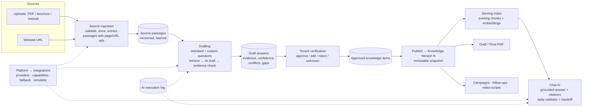

# Product Knowledge Engine — Redesign Proposal

**Status:** Proposal for approval. Nothing in this document has been implemented, and no existing knowledge-base logic has been changed.
**Source:** `peomot.txt` — the "Product Knowledge Collection, Verification, Multi-Provider Integration and PDF Generation" master prompt.
**Goal:** Turn what a tenant already has (brochures, PDFs, website) into verified, source-backed knowledge that the AI uses to answer customers in chat — with the tenant doing as little typing as possible.
**Framing, as requested:** this is treated as a **redesign of the knowledge-base engine**. Every place where the redesign would change existing logic is listed in **section 12 (Permission requests)**. None of those changes will be made without your explicit approval, item by item.

---

## 1. The proposal in one page

**What we build.** A pipeline that goes: *tenant sources → AI extraction → evidence-backed draft answers → tenant verification → a published, versioned knowledge set → the chat AI answers only from that set.*

**What stays.** The article/chunk/embedding/vector-store machinery, the structure-aware ingestion, the Hangfire indexing job, the reply validator, the handoff flow, tenant isolation and the AI-usage metering all stay. We build *on* them.

**What is genuinely new.**
1. **Evidence and verification layer** — every answer carries its source passage, page/URL, confidence category and approval history. Nothing the tenant has not approved can be said to a customer as a tenant fact.
2. **Website scanner** — does not exist today.
3. **Source-to-answer drafting** — AI searches the uploaded sources first and drafts answers; the tenant confirms or corrects.
4. **Provider layer upgrade** — capability checks, configurable fallback, per-execution log, simulator labelling, all managed from **Platform Admin → Integrations**.
5. **Draft and Final text files** — a downloadable plain-text record of the knowledge (decision: text file, not PDF — no PDF writer and no licence needed).
6. **A published knowledge version** — chat reads from one immutable, approved version at a time, so editing never silently changes what customers are told.

**What we need from you.** A decision on the 12 permission items (section 12) and the 9 open decisions (section 13). The recommended answer is given for each.

**Delivery.** 9 phases, each independently shippable and tested, each ending with an update to a requirement matrix kept in the repo (section 11).

---

## 2. What exists today (verified in the code)

I read the code rather than going by names. Where I have not verified something, it says so.

### 2.1 Knowledge base

| Area | What is there | Where |
|---|---|---|
| Storage model | `KnowledgeBaseArticle` (title, markdown content, content hash, category, **source type, authority rank**, effective dates, status Draft/Published/Archived, version number, approved-by/at, review-due, soft delete). `KnowledgeBaseArticleVersion` (immutable snapshot on publish). `KnowledgeBaseChunk` (text, context header, embedding, token count, atomic-group, denormalised filter columns). `KnowledgeIngestionJob` (state, attempts, security findings, metrics). `KnowledgeBaseArticleModelPublication` (publish an article to ChatGPT / Gemini / Claude). | `Domain/Entities/KnowledgeBase/*` |
| Scope | An article is **Global** (platform support knowledge) or **Tenant**-scoped. A tenant article's authority rank is capped (`KnowledgeAuthority.TenantMaxRank = 30`). | `KnowledgeBaseArticle.cs`, `KnowledgeAuthority.cs` |
| Categories | `KnowledgeCategory` is **support-oriented**: GettingStarted, Billing, Subscription, AiUsage, WhatsApp, Campaigns, LeadDiscovery, Conversations, Crm, Templates, Integrations, Security, Policy, Troubleshooting, ReleaseNotes. It describes the SaaS product, not a tenant's products. | `Domain/Enums/KnowledgeCategory.cs` |
| Ingestion | Structure-aware chunker, content sanitiser with security findings, embedding batching, resumable by chunk index, background job. Publishing an article runs it. | `Application/KnowledgeBase/Ingestion/*`, `BackgroundJobs/KnowledgeIndexingJob.cs` |
| Upload | Uploads become a **Draft** article with an extraction **quality score** and a "needs human review" flag. Formats: markdown/txt, PDF (PdfPig), plus the extractor list in `DocumentTextExtractor`. A scanned PDF with no text layer is **rejected** ("TooShort") — there is **no OCR**. | `KnowledgeUploadService.cs`, `DocumentTextExtractor.cs`, `Infrastructure/KnowledgeBase/PdfDocumentExtractor.cs` |
| Vector storage | Two implementations behind `IVectorStore`: SQL Server vector and a JSON-column fallback. | `Infrastructure/KnowledgeBase/*VectorStore.cs` |
| **Chat retrieval** | The sales chat calls `IKnowledgeBaseService.RetrieveRelevantChunksAsync`: embed the message → candidates = chunks of Published, tenant-scoped articles (and published to the active chat model) → **in-memory cosine** → minimum score → top N. Global articles are deliberately never quoted in a tenant's sales chat. | `KnowledgeBaseService.cs:445`, `features/knowledge-base/FLOWS.md` |
| Advanced retrieval | A second, richer retriever exists — hybrid vector + keyword, fusion, rerank, an **evidence gate**, diagnostics, caches. It is built around support tickets (intent, module, plan, version). I found it used by ingestion verification; I did **not** find it on the sales-chat path. | `Retrieval/KnowledgeRetrievalService.cs` |
| Tenant UI | Article list + form dialog; platform-side Knowledge pages for global articles. | `features/knowledge-base`, `features/platform/platform-knowledge*` |

### 2.2 AI layer

| Area | What is there |
|---|---|
| Providers | OpenAI, Google, Anthropic and **Simulated** clients exist (chat and embeddings). Provider is **platform-wide**, not per tenant. |
| Configuration | DB-backed settings under category `AiProviders` (provider, API keys, models, per-provider On/Off), edited on **Platform → Configuration**. |
| Verify Connection | `IAiProviderVerifier.VerifyAsync(provider)` exists. |
| Generic text task | `IAiTextGenerator.GenerateAsync(system, user, maxTokens, provider?)` — one-shot text, returns null on failure. Used by keyword suggestions, description refinement, lead discovery. |
| Metering | `AiUsageService` gates, charges, refunds and audits AI calls against tenant quota. |
| Chat safety | `AiReplyValidator` already checks that cited chunk ids were actually offered and **flags numbers (prices, dates, quantities) in a reply that appear nowhere in the knowledge or CRM context**. `ConversationOrchestrator` escalates to a human handoff (hybrid draft mode) and holds drafts. |
| Integrations page | **Platform → Integrations** exists and currently hosts consent-SMS / DND provider choices and AI feature panels (keyword suggestions, embeddings reading). It does **not** host the main AI provider/keys. |

### 2.3 Platform capabilities relevant to the prompt

| Need | Today |
|---|---|
| File storage | `IMediaStorageService` (S3 / local), tenant-prefixed keys. |
| Background jobs | Hangfire, with a shared-process caveat noted in the Phase 0 blueprint. |
| SSRF protection | An SSRF-aware fetcher exists for media URLs (`HttpMediaUrlFetcher`) — reusable pattern, not a crawler. |
| PDF **reading** | PdfPig. |
| PDF **writing** | **Nothing.** No PDF library is referenced. |
| Website scanning | **Nothing** for tenant product pages. |
| OCR | **Nothing.** |
| Structured verified facts | The Content Studio work now on branch `feature/content-studio-wizard-and-knowledge`: `BusinessFact` (status, origin, evidence, expiry, history), readiness rules and gaps, claim checker, tenant-scoped fact retrieval. |

**Honest summary:** the *plumbing* (chunking, embeddings, versions, vector search, jobs, metering, handoff, grounding validation) is strong. What is missing is everything that makes the knowledge **trustworthy and cheap to build for a non-technical tenant**: source evidence, AI drafting, verification, conflict handling, website input, product-oriented categories, and a published-version boundary.

---

## 3. Design principles

1. **AI drafts, the tenant approves.** Questions are answered from sources first; the tenant is asked only for what is missing, contradictory or needs sign-off.
2. **Evidence is a first-class object**, not a footnote. An answer without a real source passage cannot reach "High confidence".
3. **Approved ≠ true, and fluent ≠ evidenced.** Approval means the tenant accepted it. Confidence is computed by the application from evidence, never copied from the model's self-report.
4. **Chat reads a published version, not live drafts.** Editing a draft never changes what customers hear until the tenant publishes.
5. **Fail safe to a human.** No sufficient approved evidence → do not answer from the model's memory; clarify or hand off.
6. **Reuse before building.** Every new table or service in this document names what it reuses.

---

## 4. Target architecture

### 4.1 Two layers with a hard wall between them

| Layer | Contains | Who changes it | Who reads it |
|---|---|---|---|
| **Working layer** | Sources, passages, draft answers, conflicts, tenant edits, in-progress approvals | Tenant, background jobs | Only the knowledge-building screens |
| **Published layer** | An immutable **Knowledge Version** of approved items and their serving chunks | Only the *Publish* action | Chat, campaigns, follow-ups, video scripts, PDFs |

This is what makes "do not silently overwrite approved information" and "revalidate when a source changes" enforceable: a changed source flags working-layer items; the published version keeps serving the last approved state until the tenant re-approves and publishes.

---

## 5. Knowledge categories for the chat engine

Your note says the knowledge base has different categories and the purpose is to answer customers in chat. The existing `KnowledgeCategory` describes the SaaS itself, so product knowledge needs its own taxonomy (decision **D2**). Proposed categories, taken from section 5 of the prompt, with how each is *used* in chat:

| # | Category | Typical chat use | Handling rule |
|---|---|---|---|
| 1 | Business & product overview | "What do you do?" | Standard |
| 2 | Target audience / ideal customer | Qualifying, tone | Standard |
| 3 | Customer problems solved | Discovery | Standard |
| 4 | Features | "Does it do X?" | Standard; feature→benefit link kept |
| 5 | Benefits & customer outcomes | Persuasion | **Quantified outcomes need evidence + approval** |
| 6 | Use cases | "Is it right for me?" | Standard |
| 7 | **Pricing & plans** | "How much?" | **Material claim**: explicit approval, expiry/review date, never answered from low confidence |
| 8 | Differentiators | "Why you?" | Standard |
| 9 | **Competitor comparison** | "You vs X?" | **Material claim**: explicit approval |
| 10 | FAQs | Direct answers | Standard |
| 11 | Objections & responses | Hesitation | Standard |
| 12 | Purchase considerations | Delivery, terms, onboarding | Standard |
| 13 | **Guarantees & certifications** | Trust | **Material claim**: explicit approval + evidence document |
| 14 | **Compliance claims** | Regulated sectors | **Material claim**: explicit approval + evidence document |
| 15 | Contact & support | Next step, handoff | Standard |
| 16 | Next-step / call-to-action | "How do I start?" | Standard |

Each chat message is mapped to one or more of these (a cheap intent step), and retrieval is filtered and boosted by category. **Material-claim categories (7, 9, 13, 14, plus any outcome claim in 5) can only be served if approved and unexpired.**

---

## 6. Data model (new vs reused)

New tables are tenant-owned (`ITenantOwned`) and follow the existing configuration/migration conventions. Names are provisional.

| Entity | Purpose | Reuses |
|---|---|---|
| `KnowledgeSource` | An upload or a website. Type, name/URL, status, content hash, owner, error, retry count, duplicate-of | `IMediaStorageService` for the file; upload validation from `KnowledgeUploadService` |
| `KnowledgeSourceVersion` | A re-upload or a re-scan of the same source; hash + extraction timestamp | — |
| `SourcePassage` | The unit of evidence: text, page/section/heading or URL fragment, order, hash | Extractor output (`ExtractionResult`) |
| `KnowledgeQuestion` | Standard (template-defined) or custom (tenant-created) | Template idea from the Content Studio questionnaire |
| `KnowledgeAnswer` | Current draft: summary + detailed text, kind (source-extracted / AI-interpreted / suggested language / tenant-provided), confidence category, verification status, version | — |
| `AnswerEvidence` | Answer ↔ passage links with the exact excerpt | — |
| `KnowledgeConflict` | Two or more values for one fact, their sources, the chosen value, who resolved it | — |
| `KnowledgeAnswerRevision` | Every edit/approve/reject/clarify, by whom, when | Same pattern as `BusinessFactRevision` |
| `KnowledgeVersion` | A published snapshot: number, published by/at, item set, note | Pattern of `KnowledgeBaseArticleVersion` |
| `KnowledgeItem` | An approved answer as it appears in a version (category, text, claim class, expiry, evidence refs) | Links to existing chunks |
| `AiExecution` | Provider, model, task, tenant, correlation id, live/simulator, duration, tokens, cost, retries, fallbacks, error code. **No prompt content, no keys.** | Extends what `AiUsageService` audits |
| `AiTaskPolicy` (platform) | Per task: provider order, fallback allowed, required capability, cost cap | `AppSettingCatalog` pattern |

**Reused as-is or extended:** `KnowledgeBaseChunk` and `KnowledgeBaseChunkEmbedding` stay the *serving* index (a nullable link to the `KnowledgeItem` is the only addition — permission item **P3**); vector stores, ingestion job, chunker, sanitiser, token counter, `IMediaStorageService`, `AiUsageService`, handoff, tenant filters.

**Possibly merged:** the Content Studio `BusinessFact` table already stores verified, evidence-carrying, expiring facts with history. Decision **D1** below is whether it becomes the representation of an approved item or stays a separate, smaller thing.

---

## 7. How each part of the prompt is delivered

### 7.1 Sources (prompt §3)
- **Documents:** extend the existing upload path. Add duplicate detection by hash, a processing-status model, retry, and page-level passages (the extractor today returns markdown without page numbers — page references are a required change). **OCR is a new capability**; today scanned PDFs are rejected. Recommendation: reject-with-clear-message in phase 3, add OCR as a separate, optional step (decision **D6**).
- **Websites:** a new crawler service. Same-host scope, depth and page limits, `robots.txt` respected, per-request timeouts and size caps, content-type allow-list, **SSRF defence** (resolve DNS, block private/loopback/link-local ranges, re-check after each redirect, limited redirect count), duplicate-page detection by content hash, per-page success/failure report, source URL + timestamp on every passage. It reuses the approach in `HttpMediaUrlFetcher` but is a separate component.
- **Consolidation:** passages from all sources feed one drafting step; the source link on every passage is never dropped.

### 7.2 Drafting answers (prompt §5, §6, §7)
For each question (the 12 standard benefit/value questions, plus tenant-created ones):
1. Retrieve candidate passages (tenant sources only — hybrid vector + keyword, reusing the existing retriever's building blocks).
2. Ask the provider for a **structured JSON** draft that must quote passage ids.
3. The application **checks the quotes against the real passages** (exact/near-exact excerpt match, ids exist and belong to this tenant). Anything that fails the check is dropped — citations are never trusted, and never invented.
4. The application computes the confidence category (section 8).
5. If evidence is insufficient: state the limitation and ask one short clarifying question — never fill the gap.

Feature→benefit mapping is a second structured task producing rows (feature, problem, benefit, segment, evidence). Quantified outcomes without evidence are flagged, not accepted.

### 7.3 Confidence (prompt §9)
Computed by the application, identically for every provider:

| Category | Rule (proposed, to be validated with fixtures) |
|---|---|
| **High** | At least one verified passage directly states the answer (exact-quote check passes), no conflicting passage |
| **Medium** | Supported, but needs combining ≥2 passages or an interpretation step |
| **Low** | Partial, indirect, ambiguous, or potentially conflicting evidence |
| **No supporting evidence** | Nothing retrievable above the relevance floor |

No numeric "probability" is shown. Verification status is a separate field: a High-confidence answer is still *Pending Verification* until the tenant acts.

### 7.4 Verification UX (prompt §8, §10)
One review screen, list on the left and the chosen answer on the right (list/panel pattern already used in Facts, and the "keep the user on the page" rule). Per answer: summary, expandable detail, source chips (document + page, or URL), confidence chip, verification chip. Actions: **Confirm**, **Edit**, **Reject**, **Another suggestion**, **Unknown**, **Not applicable**, **Add missing info**. Filters by status and category; progress saved continuously; optional questions never block onboarding. Short yes/no and multiple-choice clarifications are preferred over free text.

### 7.5 Conflicts (prompt §9.4)
Detected when two passages assert different values for the same fact (price, quantity, term, date). Both values and sources are shown; the tenant picks or enters the value; the resolution and who made it are recorded. Source date never auto-decides.

### 7.6 Versioning and revalidation (prompt §12)
- Changing/replacing a source, re-scanning a site, editing an answer, resolving a conflict or approving/rejecting a claim marks the **affected** answers *Needs revalidation* (matched through the evidence links).
- Publishing creates **Knowledge Version N+1**; N stays available for audit and rollback. Approved items are never overwritten, only superseded.

### 7.7 Draft and Final knowledge file (prompt §11) — **text file, not PDF**
**Decision (owner):** the content is stored and offered as a **plain-text file**, not a generated PDF. No PDF-writing library, no licence. The file is a human-readable record; the *knowledge itself* lives in the database and is what the onboarding assistant and the customer chat read.

- **Draft file** — generated from the working layer: all answers with their source references, confidence, verification status, conflicts, missing and unresolved questions, clearly headed "DRAFT — NOT APPROVED".
- **Final file** — generated from a published Knowledge Version: approved items only, grouped by category, with source references. Unresolved, conflicting or pending content cannot appear in it as fact — enforced in code and covered by a test.
- Format: UTF-8 `.txt` with clear headings and numbered sections (so it reads well, and is also easy to feed to any AI tool). The same content can be offered as `.md` later at no extra cost.
- **Purpose, restated:** the primary objective of product knowledge collection is (1) to answer the tenant's own questions during onboarding and (2) to answer customers' concerns in AI-powered chat. The text file is a by-product for review and record keeping, not the knowledge store.
- The PDF *reader* (PdfPig, already in the project) is unchanged and is still what extracts text from tenants' uploaded PDFs.

### 7.8 Serving the chat (prompt §9.6, §11.3)
Replaces what the chat reads, **behind a per-tenant switch**, so the current behaviour remains the default until you opt a tenant in:
1. Classify the customer message into category(ies).
2. Retrieve only from the tenant's **current published Knowledge Version**.
3. Apply the evidence gate (relevance floor + category rules). Below the gate → clarify or hand off; never answer from model memory.
4. Material-claim categories are served only when approved and unexpired.
5. The existing `AiReplyValidator` (cited-chunk check, ungrounded-number check) runs on the reply; I propose extending it to also reject a reply that states a material claim not backed by an approved item (**P7**).
6. Citations (item/version ids) are stored with the AI turn, as chunk citations are today.

### 7.9 Provider layer (prompt §4)
Built on what exists; **no second configuration system**.

- **Home:** Platform Admin → Integrations gets the AI provider panels (Simulator, OpenAI ChatGPT, Google Gemini, Anthropic Claude): enable, credential (stored via the existing secret mechanism, never shown to tenants, never logged), model, **Verify Connection** (reuses `IAiProviderVerifier`), status, last verified, error text, capability list, change audit.
- **Capabilities:** a declared and *tested* matrix per provider and per task (document analysis, structured extraction, grounded Q&A, questionnaire generation, conflict detection…). A capability shows as "verified" only after a real call passes; otherwise "declared, not verified".
- **One resolver:** a single task-execution service resolves tenant + task → provider, checks enabled/configured/capable, runs, validates the response schema, writes `AiExecution`, returns result or a meaningful failure. Individual features stop picking providers themselves.
- **Fallback:** ordered, configurable per task (e.g. ChatGPT → Gemini → Claude), respecting capability, cost cap, rate limit and a tenant data-processing permission. Every fallback is logged. **Never falls back to the Simulator and reports success.** Non-idempotent external operations are not auto-retried.
- **Simulator:** deterministic scenarios (supported, missing evidence, conflicting sources, malformed JSON, provider error). Every result is stamped `Simulator`, never marked verified, never eligible for publication without tenant approval. It does not pretend to retrieve.

### 7.10 Security and tenancy (prompt §14)
Tenant filter plus explicit tenant id on every new query (the pattern used in the Content Studio services); backend authorization on every endpoint (never UI-only); Platform-Admin-only integration endpoints; upload type/size/magic-byte validation, safe extraction, malware-scan hook; SSRF defence on the crawler; credential masking; no document text or keys in logs; cross-tenant retrieval tests.

---

## 8. Tenant experience (prompt §2)

1. **Add sources** — drop files, paste the website URL. A progress list shows each source: reading → extracted → failed (with a plain reason and a Retry).
2. **Review** — the AI shows what it found: *"We found 14 answers. 9 look solid, 3 need a quick check, 2 we couldn't find."* Solid ones are one tap to confirm.
3. **Fill the gaps** — only the unresolved questions, each with a short example and a yes/no or multiple-choice where possible. "I don't know" is always allowed.
4. **Ask your own question** — type a question; the AI answers from the sources with citations.
5. **Publish** — one button: "Use this knowledge in chat". The PDF can be downloaded as a record.
6. **Stays current** — if a document or the website changes, only the affected answers come back for a re-check.

The readiness and gap engine already built for Content Studio (scoring, "what's missing", defer/skip) can drive step 3 and the progress meter, rather than being rebuilt.

---

## 9. Phased delivery

Each phase ends with: tests run and reported honestly, the requirement matrix updated, and a pause for your review.

| Phase | Scope | Existing logic touched? | Size |
|---|---|---|---|
| **0** | Requirement matrix file created; this proposal approved; decisions D1–D9 and permissions P1–P12 answered | No | S |
| **1 Integration foundation** | Integrations-page AI provider panels, capability matrix, single task resolver, fallback policy, `AiExecution` log, simulator scenarios, credential protection | **Yes — P5, P6** | L |
| **2 Source ingestion** | Source/passage tables, upload hardening, duplicate detection, status/retry, page-level passages, website crawler with SSRF defence | Light — **P3, P11** | L |
| **3 Drafting & evidence** | Standard + custom questions, retrieval→draft→quote-check, confidence engine, conflict detection, feature→benefit mapping | No (new services) | L |
| **4 Verification UX** | Review screen, actions, filters, revisions, resume | No | M |
| **5 Versions & publish** | Knowledge Version, items, revalidation on change, supersede/rollback | **Yes — P3, P8** | M |
| **6 Knowledge files** | Draft + Final text file | No new dependency | S |
| **7 Chat serving** | Category routing, published-version retrieval, evidence gate, material-claim rules, validator extension — behind a per-tenant switch | **Yes — P1, P2, P4, P7** | L |
| **8 Downstream & hardening** | Campaigns/follow-ups/video scripts read the published version; security suite; cost/limits | **Yes — P10** | M |
| **9 Final audit** | Requirement-by-requirement audit, honest status report | No | S |

Phases 1 and 2 can be built in parallel by two people; 3→4→5 are sequential; 6 can run alongside 5.

---

## 10. Testing approach

Same stack as today (xUnit with SQLite test host; Jasmine/TestBed for tenant screens). Specifically:

- **Pure-rule tests** (no DB): confidence classification, quote verification, conflict detection, claim-class rules, version/revalidation matching, PDF content selection.
- **Service tests with a database:** tenant isolation on every new endpoint (cross-tenant returns 404), role denial, approval history, supersede behaviour.
- **Provider tests, kept honest:** adapters tested against recorded/mocked HTTP responses and labelled *mocked*; a separate, opt-in "live" suite runs only when real keys are configured. The final report will list, per provider, whether a **real** call succeeded. Configuring a provider is never reported as "tested against the real API" unless it was.
- **Security tests:** SSRF payload list (private IPs, DNS rebinding, redirects to internal hosts), upload abuse, log scrubbing, credential masking.
- **Chat tests:** unapproved/expired/low-confidence material claim → not served; no evidence → clarify/handoff; simulator output never published as verified.
- I will not claim a test passed unless it ran.

---

## 11. Traceability

On approval, phase 0 creates `docs/product-knowledge-requirement-matrix.md` in the repo and updates it after every phase (as the prompt recommends). Each numbered section and sub-requirement gets an ID (`PK-3.1-a` …), the existing code it maps to, the planned change, the test, the actual result and one of: COMPLETE AND VERIFIED / IMPLEMENTED BUT NOT FULLY VERIFIED / PARTIALLY IMPLEMENTED / BLOCKED / NOT IMPLEMENTED / NOT APPLICABLE.

**Section-level starting position (before any work):**

| Prompt § | Topic | Status today |
|---|---|---|
| 3.1 | Document upload | **Requires modification** (page refs, dup detection, status/retry, OCR gap) |
| 3.2 | Website scanning | **Requires new implementation** |
| 3.3 | Multi-source consolidation | **Requires new implementation** |
| 4 | AI providers/simulator in Integrations | **Requires modification** (providers exist, config lives elsewhere, no capability/fallback/execution log) |
| 5 | Extraction & consolidation | **Requires new implementation** |
| 6 | Benefits & customer value | **Requires new implementation** |
| 7 | Tenant-created questions | **Requires new implementation** |
| 8 | Answer presentation & verification UX | **Requires new implementation** |
| 9 | Confidence & traceability | **Requires new implementation** (grounding validator is a partial precursor) |
| 10 | Approval & audit | **Partly exists** (fact history in Content Studio; article approval) → extend |
| 11 | Draft / Final knowledge file | **Requires new implementation** (text file; no PDF writer needed) |
| 12 | Versioning & revalidation | **Requires modification** (article versions exist; no evidence-linked revalidation) |
| 13 | Execution logging | **Requires modification** (usage audit exists; no per-execution provider/fallback record) |
| 14 | Security & isolation | **Already strong** (tenant filters, secrets); new surfaces need tests |
| 17 | Tests | New per phase |

---

## 12. Permission requests — changes to existing logic

You asked that anything that changes existing knowledge-base logic be put to you first. **Nothing below is done.** For each: what changes, why, how it is contained, and my recommendation. Answer *Approve / Approve with changes / Decline* per item.

| ID | Existing logic | Proposed change | Containment | Recommendation |
|---|---|---|---|---|
| **P1** | `ConversationOrchestrator` reads grounding from `IKnowledgeBaseService.RetrieveRelevantChunksAsync` | At the call site, read from a new serving service when the tenant has the new engine on | Per-tenant switch, **default off**; old path untouched when off; one call-site change | **Approve** — this is the point of the redesign |
| **P2** | `KnowledgeBaseService.RetrieveRelevantChunksAsync` (in-memory cosine over all tenant chunks) | Leave it as is; the new serving service is a separate class (it may reuse `RankingMath`/`IVectorStore`). Optionally later: route this method through the new service | None if left as is | **Approve "leave as is"** now; revisit after rollout |
| **P3** | `KnowledgeBaseChunk` / article tables | Add nullable columns linking a chunk to a `KnowledgeItem` and a `KnowledgeVersion` (migration touching existing tables); no column removed or retyped | Additive nullable columns; existing rows unaffected | **Approve** |
| **P4** | Publish flow and the **"published to ChatGPT/Gemini/Claude"** per-model gating (`KnowledgeBaseArticleModelPublication`) | New-engine content does **not** use per-model publication (provider is chosen centrally); existing articles keep it | The old gate is untouched for existing articles | **Approve** |
| **P5** | AI provider/key configuration lives on **Platform → Configuration** (`AiProviders` category) | Add the provider panels to **Platform → Integrations** as the primary home; keep the existing settings keys and storage; decide whether Configuration shows them read-only or hides them | Same keys, so no data move; only where they are edited changes | **Approve with changes**: show in Integrations, leave Configuration entries visible but marked "managed in Integrations" |
| **P6** | Shared AI plumbing (`AiServiceFactory`, `AiTextGenerator`, `ActiveAiProviderAccessor`) used by keyword suggestions, lead discovery, description refinement, chat | Add capability checks, fallback and execution logging **in a new resolver**; existing features keep calling their current entry points. Migrating them to the resolver is optional and one-by-one | Additive; no behaviour change for existing features unless you opt each in | **Approve (additive only)** |
| **P7** | `AiReplyValidator` | Add a rule: a reply that states a material claim not backed by an approved item is rejected | New rule gated by the tenant switch | **Approve** |
| **P8** | `KnowledgeCategory` enum (support taxonomy) | Do **not** change it; introduce a separate `ProductKnowledgeCategory` | No change to existing enum | **Approve "separate taxonomy"** |
| **P9** | Content Studio `BusinessFact` tables and services (my Phase 1–2 work, in PRs #69/#76, unmerged) | Decide D1: keep separate, or have approved items also populate facts so readiness/gap/claim tools work on the new knowledge | Facts are new and unmerged, so low risk | See D1 |
| **P10** | `AiUsageService` quota types | Add quota types / charge kinds for extraction and drafting jobs, or reuse `ContentGenerations` | Additive enum values; plans need the new limits | **Approve** (needs your pricing view) |
| **P11** | Project dependencies | Add an HTML parser for the crawler. **No PDF-writing library** (text file chosen) and **no OCR engine** (AI-vision toggle chosen). PdfPig is already referenced. | New package(s) only | **Approve** |
| **P12** | `AppSettingCatalog` and platform settings | Add settings for crawler limits, fallback order, thresholds, retention | Additive keys with defaults | **Approve** |

---

## 13. Open decisions

| # | Decision | Options | Recommendation |
|---|---|---|---|
| **D1** | Relationship with Content Studio `BusinessFact` | (a) separate; (b) approved items also create/update facts | **(b)** — one place for readiness, gaps, claim checks, and the video/script side; the new engine adds richer answers and evidence on top |
| **D2** | Category taxonomy | the 16 in section 5, or trim | Start with all 16; hide unused ones per industry |
| **D3** | Where the new engine's data lives | New tables + link to existing chunks (this proposal) vs. extend the article table | **New tables** — keeps the working layer separate from the published layer |
| **D4** | Rollout | Per-tenant switch, default off | **Yes**, starting with the pilot tenant |
| **D5** | Draft/Final output format | **Decided: text file** (no PDF, no licence) | Done |
| **D6** | OCR | **Decided:** use the selected AI provider's vision to read scanned pages, behind an Integrations-page toggle, default OFF; needs tenant data-processing consent (D8) | Done |
| **D7** | Crawl scope | Same host, depth ≤2, ≤50 pages, robots-respecting | Start there, configurable in settings |
| **D8** | Data-processing permission | Tenants consent before documents go to an external AI provider; per-tenant allowed-provider list | **Yes** — needed for fallback rules and for privacy |
| **D9** | Languages | English only vs. Hindi/Hinglish sources and answers | Sources in either; answers in the tenant's chosen language |

---

## 14. Risks and limits

- **Provider differences:** structured-output behaviour, context limits and model names differ; hence declared-vs-verified capabilities and schema validation on every response.
- **Cost:** extraction and drafting can be token-heavy on long brochures. Mitigations: dedupe by hash, per-task cost caps, metering through `AiUsageService`, summarise-then-extract for very long documents.
- **Quote checking is strict by design:** some good paraphrased answers will land as Medium rather than High. That is the intended trade-off.
- **Website content is untrusted input:** it can carry prompt-injection text. Crawled text is treated as data, never as instructions; outputs are schema-validated.
- **Hangfire hosting:** background extraction shares the API process today (a known item from the Phase 0 blueprint).
- **Not verifiable from here:** live OpenAI/Gemini/Claude calls require real keys; I will report which providers were genuinely exercised.
- **Existing-code assumptions to re-verify before phase 7:** that the advanced hybrid retriever is not on the sales-chat path (I found it only in ingestion verification), and the exact set of extractors registered for upload.

---

## 15. What I need from you to start

1. Answer **P1–P12** (Approve / Approve with changes / Decline).
2. Answer **D1–D9** (or accept the recommendations).
3. Confirm the first phase to start (recommended: **Phase 1, Integration foundation** and **Phase 2, Source ingestion**).

Once approved, the first action is creating `docs/product-knowledge-requirement-matrix.md`, then Phase 1.
