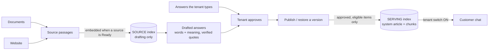
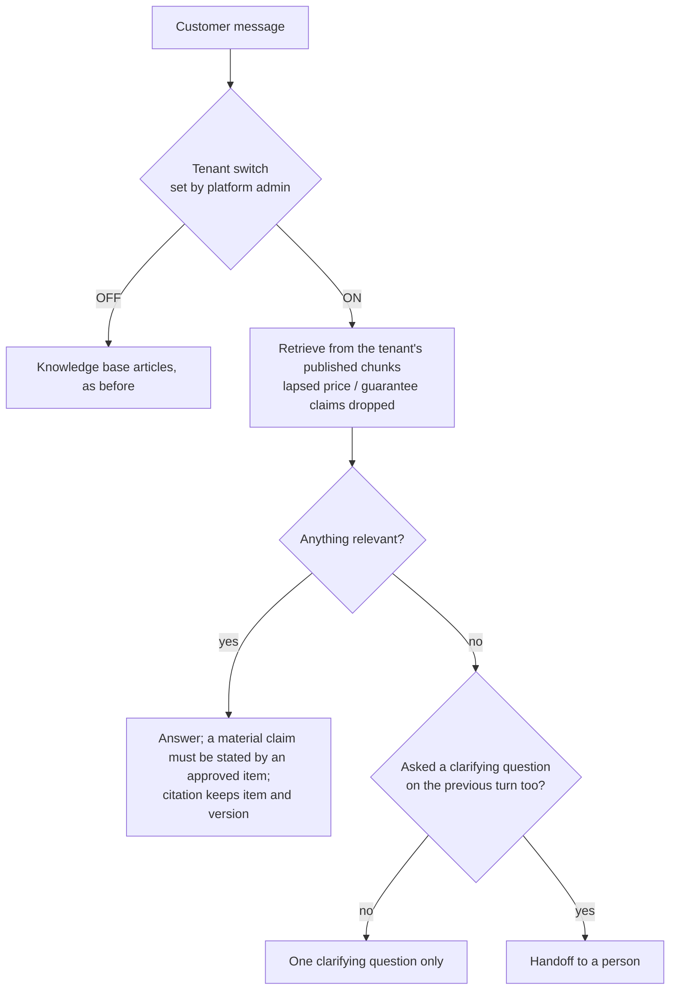
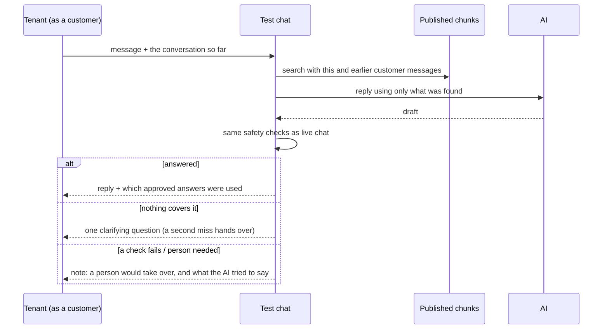

# Product knowledge - flows

What the AI knows about a tenant's products comes from three inputs only: **documents**, the **website**, and **answers the tenant types or edits**. The tenant no longer writes knowledge-base articles; those screens are gone from the tenant app (the endpoints, ingestion, vector stores, retrieval and the platform admin's Global knowledge stay).

## From sources to chat



The two indexes never mix: the source index is read only when drafting; chat reads only the serving index.

## Publishing and the chat index

```mermaid
sequenceDiagram
    participant T as Tenant admin
    participant P as Publishing
    participant I as Serving indexer
    participant K as Ingestion pipeline
    T->>P: Publish (or restore a version)
    P->>P: save the version (immutable items)
    P->>I: build the chat index
    I->>K: render items as sections, publish the system article
    alt indexing finishes
        K-->>I: chunks swapped in atomically
        I-->>P: version is Live (older Live becomes Replaced)
    else it fails
        I-->>P: version is Failed with a reason
        Note over P,K: the publish stands; chat keeps the last Live version; Try again rebuilds it
    end
```

## What chat does



## Test chat

The tenant can talk to the AI as a customer would, from **Test Chat**. It reads the live published version (whether or not live chat is switched over) with live chat's own retrieval, prompt and safety checks, and stores and sends nothing.


